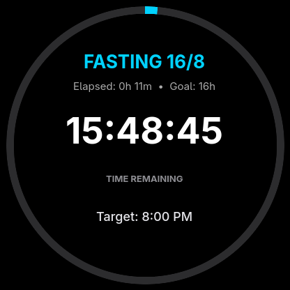

# Garmin Fasting Widget

An intermittent fasting tracker widget built in Monkey C for the **Garmin Instinct 3 AMOLED (50mm)**.

<p align="center">
  
</p>

## Highlights

- **AMOLED-Optimized (416 × 416)**: Pure black background (`#000000`) with zero idle battery impact.
- **Glance View**: Shows active state, elapsed time, and progress bar in the widget loop without opening the app.
- **Physical Button Controls**: 100% button-driven navigation designed for the Instinct hardware (no touch needed).
- **On-Wrist Time Adjustments**: Quick-shift windows by ±15 minutes using `UP` / `DOWN`, or fine-tune via the menu.
- **Offline Storage**: Keeps a rolling on-device history of the last 30 completed fasts.
- **Private LAN Sync**: Automatically pushes completed fasts to a self-hosted HTTP API on your home network.

---

## Controls

| Button | Action |
| :--- | :--- |
| **GPS / START** | Open Action Menu (Start/End Fast, Shift Time, Sync Now, History, Reset) |
| **UP** | Shift Fasting Window (+15 min) |
| **DOWN** | Shift Fasting Window (-15 min) |
| **BACK / SET** | Return to Watch Face / Glance Loop |

---

## Requirements

- **Garmin Connect IQ SDK**: 9.2.0+
- **Device Profile**: `instinct3amoled50mm`
- **Java**: OpenJDK 17+
- **Developer Key**: 4096-bit RSA signing key (`developer_key.der`)

---

## Build & Sideload

### 1. Build PRG Binary
```bash
./scripts/build.sh
```
Compiles `bin/FastingWidget.prg` using Connect IQ SDK `monkeyc`.

### 2. Sideload to Watch (Linux MTP)
Connect your Instinct 3 AMOLED via USB and run:
```bash
./scripts/install.sh
```
The script detects the watch via MTP (`091e:51eb`), copies `Fasting.prg` to `GARMIN/Apps/`, and unmounts cleanly.

### 3. Interactive Web Preview
To test UI layouts locally without deploying to the physical device:
```bash
./scripts/preview.sh
```

---

## Local Network Sync

The widget syncs completed fasting sessions to a custom self-hosted endpoint configured in Garmin Connect Mobile app settings:

- **Method**: `POST`
- **Format**: JSON
- **Payload Example**:
  ```json
  {
    "device": "instinct3amoled50mm",
    "token": "your-auth-token",
    "records": [
      {
        "id": 1727434800,
        "start": 1727434800,
        "end": 1727492400,
        "target": 16,
        "duration": 16.0,
        "state": "COMPLETED"
      }
    ]
  }
  ```

A reference receiver server is provided in [`scripts/sample_local_server.py`](scripts/sample_local_server.py).

---

## Documentation

- [`docs/ARCHITECTURE.md`](docs/ARCHITECTURE.md): FSM lifecycle, storage schema, and background alerts.
- [`docs/UI_SPECIFICATION.md`](docs/UI_SPECIFICATION.md): Typography, color palette, and 416 × 416 circular layout.
- [`docs/LOCAL_API_SPEC.md`](docs/LOCAL_API_SPEC.md): Home LAN API specification and SSL setup.
- [`docs/DEVELOPMENT_GUIDE.md`](docs/DEVELOPMENT_GUIDE.md): Detailed toolchain setup, device profile installation, and debugging.

---

## License

[MIT](LICENSE) © 2026 Oleksandr
